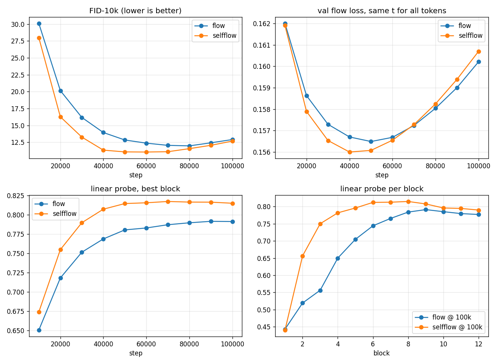
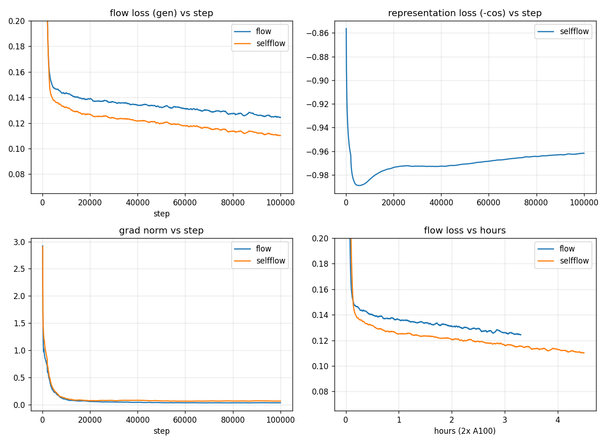
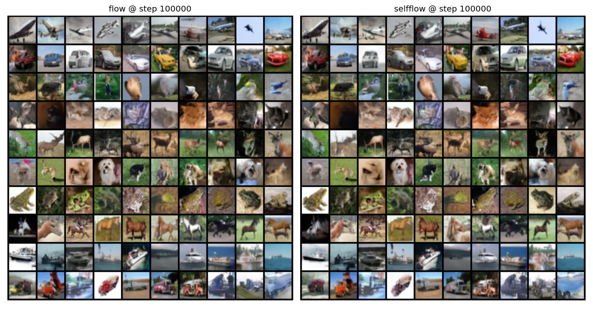

# minSelfFlow

Minimal implementation of **Self-Flow** — *Self-Supervised Flow Matching for Scalable Multi-Modal Synthesis* ([arXiv:2603.06507](https://arxiv.org/abs/2603.06507)), trained on CIFAR-10 and compared against plain flow matching.

## Idea

Flow matching mostly asks a model to denoise each patch from its neighbours, which gives little reason to learn *semantic* features. REPA fixes this by aligning features to a frozen DINOv2; Self-Flow does it with no external model:

- **Dual-Timestep Scheduling** — ~25% of tokens get noise level `s`, the rest `t`. The model must infer heavily-noised tokens from cleaner ones.
- **EMA teacher** — the teacher (an EMA of the student) sees the cleaner view (all tokens at `min(t, s)`); the student's block 4 (via a small head) must predict the teacher's block 8 features. `L = L_flow + 0.8 · L_rep`.

**Paper's claims:** stronger representations (better linear probes) and better generation than vanilla flow matching, beating REPA on ImageNet (FID 5.70 vs 5.89) without DINOv2, ~2.8× faster convergence than REPA on text-to-image, and good scaling across image / video / audio.

## Results (CIFAR-10, 32×32, class-conditional)

Same 33M-parameter DiT (12 blocks, dim 384, patch 2, pixel space), batch 512, lr 2e-4, 100k steps, 2× A100 each.
Evaluated on EMA weights every 10k steps: **FID-10k** (50 Euler steps, no CFG, vs train stats), **linear probe** on mean-pooled block features of the test set (image lightly noised, *no class label* given), and **val flow loss** with the same `t` for every token (fair to both methods).

| | best FID ↓ | best linear probe ↑ | wall-clock (100k steps) |
|---|---|---|---|
| Flow matching | 11.97 (80k) | 79.1% (block 9) | 3.3 h |
| **Self-Flow** | **11.05** (60k) | **81.7%** (block 8) | 4.5 h |



| step | 10k | 20k | 30k | 40k | 60k | 80k | 100k |
|---|---|---|---|---|---|---|---|
| FID flow / Self-Flow | 30.1 / **28.0** | 20.2 / **16.3** | 16.2 / **13.3** | 13.9 / **11.3** | 12.4 / **11.1** | 12.0 / **11.6** | 12.9 / **12.7** |
| probe flow / Self-Flow | 65.1 / **67.4** | 71.8 / **75.5** | 75.2 / **79.0** | 76.9 / **80.7** | 78.3 / **81.5** | 79.0 / **81.6** | 79.1 / **81.5** |

Training curves (flow loss, representation loss, grad norm) and samples at 100k (each row is one class, same starting noise):




## Learnings

1. **The paper's claim holds at tiny scale.** Self-Flow is ahead on both FID and linear probe at *every* checkpoint, with no external model.
2. **Per step it converges ~1.3× faster** (FID 13.3 at 30k vs the baseline's 13.9 at 40k). **But each step costs ~37% more** (extra teacher forward + head), so for *generation* the wall-clock speedup mostly disappears early on; Self-Flow still reaches a better best FID (11.05 at 2.7 h vs 11.97 at 2.6 h).
3. **Representations improve the most.** Self-Flow hits the baseline's final probe accuracy (79%) at 30k steps — ~2× faster in wall-clock — and ends 2.5 points higher.
4. **It's the shallow layers that change.** Per-block probe: block 3 goes 56% → 75%, block 4 (the student layer) 65% → 78%. The rep loss makes early blocks predict what block 8 of a cleaner view sees, so semantics appear much earlier in the network. The best block moves from 9 to 6–8.
5. **Don't compare training losses across methods.** Self-Flow's training flow loss looks much lower (0.112 vs 0.124), but it's measured on dual-timestep inputs where clean tokens leak information. On the same vanilla inputs the two are nearly identical — the gain is in sample quality and features, not in the loss.
6. **Flow loss isn't a quality score.** It plateaus around 0.12–0.16 because many (noise, data) pairs pass through the same point; FID kept improving long after the loss flattened.
7. **CIFAR overfits.** 100k × 512 ≈ 1000 epochs over 50k images. Val loss bottoms at 40–50k and FID at 60–80k, then both get worse. Self-Flow peaks earlier, so the final-checkpoint gap (12.7 vs 12.9) understates it — compare best checkpoints, or use more data.
8. **The rep loss looks "solved" (cos ≈ 0.96–0.99) and still helps.** Early on teacher ≈ student, so cosine is ~1; as the EMA slows (decay → 0.9999) the target lags and the loss *rises* slightly. That's the target getting harder, not training failing.
9. **Practical gotchas:** EMA needs a warmup (averaging very early weights gives pure-noise samples); `torch.compile` needed LR warmup to avoid loss spikes; when probing a class-conditional model, give it the null label or the probe just reads the label back.

Caveats: one seed per method, FID on 10k samples, pixel space at 32×32, ~150× smaller model than the paper. Differences of < 0.5 FID are within noise.

## Reproduce

```bash
make install && make test
# train (one run per 2 GPUs; outputs in runs/<name>/)
CUDA_VISIBLE_DEVICES=0,1 uv run torchrun --nproc_per_node=2 --master_port=29501 -m minselfflow.train --method flow --out_dir runs/flow
CUDA_VISIBLE_DEVICES=2,3 uv run torchrun --nproc_per_node=2 --master_port=29502 -m minselfflow.train --method selfflow --out_dir runs/selfflow
# evaluate every EMA snapshot (re-run to pick up new ones), then plot to assets/
CUDA_VISIBLE_DEVICES=0 uv run python -m minselfflow.evaluate --run runs/flow
CUDA_VISIBLE_DEVICES=1 uv run python -m minselfflow.evaluate --run runs/selfflow
uv run python scripts/plot_runs.py
```

`notebooks/minselfflow.ipynb` walks through each piece step by step.

## License

MIT
